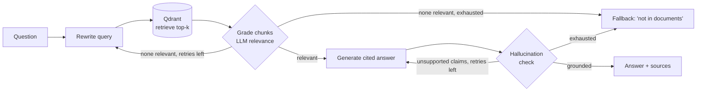

# DocuMind AI

A **self-correcting Retrieval-Augmented Generation (RAG)** system. Upload your own PDFs, ask questions with
cited answers, and measure quality against a **ground-truth set generated from those same PDFs**.
Built with **Python, LangChain, LangGraph, Qdrant, and OpenAI / Gemini**. No hardcoded data anywhere.

## Quick start

```bash
python -m venv .venv && source .venv/bin/activate
pip install -r requirements.txt
cp .env.example .env            # set LLM_PROVIDER and OPENAI_API_KEY (or GOOGLE_API_KEY)
python -m documind.cli ui       # opens the web app
```

In the web app:
1. **Knowledge base** - drag in PDFs (also DOCX/MD/TXT) and click *Index*. See, replace or delete documents anytime.
2. **Chat** - ask questions; answers carry `[n]` citations, expandable source snippets, and 👍/👎 feedback.
3. **Evaluation** - generate ground truth from your documents (or upload your own Q&A file), review/edit it in a table,
   run it, and see retrieval / answer-quality / hallucination metrics.
4. **Analytics** - live outcome rates, self-correction rate, latency and user feedback.

Prefer a terminal or API? Everything is also available there (below).

## Using your own PDFs as ground truth

**Option A - generate it from your documents (default).** `Evaluation -> Generate ground truth`
(or `python -m documind.cli eval-gen --name my-eval --n 30 --unanswerable 8`).

| Kind | How it's made | What it measures |
|---|---|---|
| Answerable | Chunks are sampled round-robin across your documents. An LLM writes a standalone question, a reference answer and verbatim keywords from that chunk. The chunk is stored as **evidence**. | Retrieval (did the right document/chunk come back?), answer correctness, keyword recall |
| Unanswerable | The LLM writes plausible questions your documents don't answer. Each is **verified against your index**; any that retrieve a relevant passage are discarded. | Whether the system **abstains instead of hallucinating** |

Quality guards: questions that say "the passage/this document" are rejected, duplicates are dropped, and keywords the
LLM invented (not literally in the source chunk) are removed.

**Option B - bring your own Q&A.** Upload a `.csv` / `.jsonl` (`Evaluation -> Upload my own Q&A file`, or
`python -m documind.cli eval-import qa.csv --name mine`):

| column | required | notes |
|---|---|---|
| `question` | yes | |
| `reference` | no | enables the LLM-judge score |
| `expected_source` | no | filename, enables retrieval hit-rate / MRR |
| `answerable` | no | `true` (default) / `false` for questions that should be refused |
| `must_include` | no | `30 days;annual` - strings a correct answer must contain |

Either way, **review the set in the editor before trusting the numbers** - fix wrong references, delete bad questions, add your own.

### Reading the results
- **Retrieval hit (doc / chunk), MRR** - scored on the raw top-k from Qdrant *before* LLM grading, so it isolates the retriever. Chunk-level is stricter (neighbouring chunks may also contain the answer, so it can under-count).
- **Judge score /5** and **keyword recall** - answer correctness (judge needs a `reference`).
- **Abstains when unanswerable** - your hallucination guard; should be near 100%.
- **Grounded rate, self-correction rate, latency p50/p95.**
- Per-question CSV + JSON summary are saved in `eval_runs/`.

> Caveats: synthetic questions are written from the very text they test, so they tend to overlap lexically with it and
> can **flatter retrieval scores** - treat them as a regression baseline and add a handful of real user questions.
> The same model family writes and judges answers, which can bias scores. Scanned/image-only PDFs have no text layer
> and are reported as such (OCR is not included).

## How the RAG pipeline works



| Resume claim | Where it lives |
|---|---|
| RAG with **LangChain + LangGraph** orchestration | `documind/graph.py` - stateful graph, conditional routing, retry loops |
| **Qdrant** vector DB | `vectorstore.py`, `ingestion.py`, `kb.py` - cosine collection, deterministic chunk IDs, write-then-prune re-indexing |
| **Prompt engineering** to reduce hallucinations | `prompts.py` - grounding rules, citations, abstention phrase, injection guard, versioned |
| **Data analysis / QA** pipelines | `metrics.py` (interaction analytics + feedback), `evalgen.py` + `evalsets.py` + `evaluate.py` (ground-truth generation and scoring) |
| **OpenAI / Gemini** | `llm.py` - `LLM_PROVIDER` switch |

## CLI

```bash
python -m documind.cli ingest report.pdf docs/      # add files or folders
python -m documind.cli sources                      # list indexed documents
python -m documind.cli remove report.pdf
python -m documind.cli ask "..."                    # one question   (or: chat)
python -m documind.cli eval-gen --name my-eval --n 30 --unanswerable 8 [--sources a.pdf b.pdf]
python -m documind.cli eval-import qa.csv --name mine
python -m documind.cli eval-sets
python -m documind.cli eval --set my-eval [--no-judge]
python -m documind.cli stats
```

## API (`python -m documind.cli serve` -> http://localhost:8000/docs)

| | |
|---|---|
| `POST /sources` (multipart `files`) / `GET /sources` / `DELETE /sources/{name}` | manage the knowledge base |
| `POST /ask`, `POST /feedback`, `GET /metrics` | Q&A, thumbs, analytics |
| `POST /eval/generate`, `POST /eval/import`, `GET /eval/sets[/{name}]`, `POST /eval/run` | ground truth + evaluation |

## Qdrant

No config = embedded local storage in `./.qdrant` (**one process at a time**). To run the web app and API together, or for
production, start a server (`docker compose up -d`) and set `QDRANT_URL=http://localhost:6333` (or Qdrant Cloud + `QDRANT_API_KEY`).

## Tests

```bash
pytest -q    # 26 tests; fake LLMs + real embedded Qdrant + a generated real PDF - no API keys or network
```

## Design notes
- **Idempotent, safe indexing:** chunk IDs are content-hashed. Re-uploading a changed file writes new chunks first, then removes stale ones, so a failed embedding call never wipes a document. One bad file never aborts a batch.
- **Cost/latency tradeoff:** grading and grounding add LLM calls per question; lower `TOP_K` or use a smaller model to trade quality for speed.
- **Separate collection per provider** because embedding dimensions differ between OpenAI and Gemini.
- **Prompt-injection hardening:** retrieved text is treated as untrusted data in every prompt.
- **Fail loudly:** API/key failures during generation or evaluation raise real errors (or are recorded per question) instead of silently producing empty sets.
